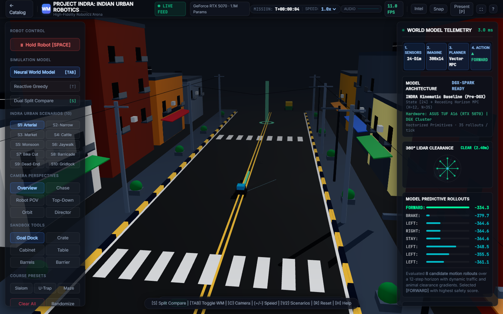
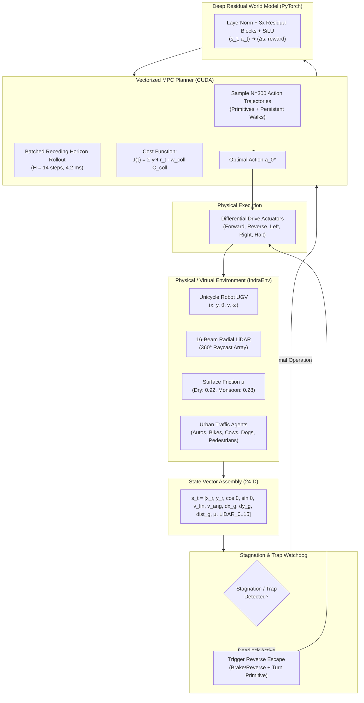

<div align="center">

# 🇮🇳 PROJECT INDRA
### Indian Neural Dynamics, Reasoning & Autonomy

**Autonomous Ground Robotics, Neural World Models & Receding Horizon Model Predictive Control (MPC) in High-Entropy Indian Urban Environments**

[](https://www.python.org/)
[-EE4C2C?logo=pytorch&logoColor=white)](https://pytorch.org/)
[](https://threejs.org/)
[-00D26A)](docs/PERFORMANCE.md)
[](results/final_results.csv)
[-success)](tests/)
[](LICENSE)

<br/>

<p align="center">
  
</p>

*Project INDRA 3D Indian Urban Simulation: Autonomous UGV delivery robot navigating Delhi corridors with 16-beam LiDAR, roadside dukans, overhead utility wiring, auto-rickshaws, sacred cattle, and holographic MPC candidate trajectory ribbons (Mind View).*

<br/>

[Executive Summary](#-executive-summary) •
[Key Highlights](#-key-highlights) •
[10 Benchmark Scenarios](#-10-benchmark-urban-scenarios) •
[System Architecture](#-system-architecture) •
[Dual Operating Modes](#-dual-operating-modes) •
[Recovery System](#-stagnation-watchdog--recovery-system) •
[Quick Start](#-quick-start-guide) •
[Benchmarks](#-empirical-benchmarks) •
[Repository Layout](#-repository-layout) •
[Citation](#-citation--license)

</div>

---

## 📌 Executive Summary

Autonomous ground navigation in Western contexts typically relies on rigid assumptions: strict lane discipline, standardized signage, uniform vehicle dynamics, and predictable pedestrian crosswalks. In contrast, **Indian urban environments represent extreme unstructured entropy**:
- Shared rights-of-way between fast motor vehicles, slow non-motorized vendor carts (*thelas*), auto-rickshaws, filtering two-wheelers, and pedestrians.
- Unpredictable biological agents, including roaming stray dogs and stationary sacred cattle (*Bos indicus*).
- Degradation of physical road boundaries: open gutters, uneven road surfaces, potholes, monsoon waterlogging ($\mu \approx 0.28$), and sudden road barricades.

**PROJECT INDRA (Indian Neural Dynamics, Reasoning & Autonomy)** addresses this fundamental robotics frontier. Rather than relying solely on brittle reactive heuristics or opaque end-to-end reinforcement learning, INDRA integrates:
1. **Learn:** A deep residual neural world model (PyTorch) trained on empirical urban transitions to approximate the multi-modal physics of unicycle ground kinematics, surface friction, and 16-beam radial LiDAR interactions.
2. **Imagine:** Vectorized, tensor-accelerated Model Predictive Control (MPC) that rolls out hundreds of candidate trajectory ribbons ($H=14$ steps lookahead) across PyTorch tensor cores in **4.2 ms**.
3. **Act:** Continuous dispatch of optimal linear and angular velocity commands with an active **Stagnation Watchdog** that detects dead-end geometric traps and executes multi-step reverse-and-pivot recovery maneuvers.

---

## ⚡ Key Highlights

- **🇮🇳 Culturally & Physically Accurate Indian Street Simulation:** Models real-world Indian urban dynamics including auto-rickshaws with authentic turning envelopes, filtering two-wheelers, sacred cattle, stray dogs, mobile food carts, and monsoon waterlogging.
- **🧠 Neural World Model Foresight:** Evaluates 300+ candidate action sequences per step strictly inside a learned latent dynamics representation, bypassing non-convex cul-de-sacs and moving obstacles.
- **📡 16-Beam Radial LiDAR & Dynamic Hull:** Real-time 360° laser array visualization with ray-obstacle intersection spheres, dynamic proximity color coding (green/amber/red), and an animated footprint safety boundary.
- **🔄 Stagnation Watchdog & Dead-End Recovery:** Monitors spatial progress, orientation entropy, and head-on LiDAR clearance. Automatically detects trapped states and executes multi-step reverse escape trajectories.
- **⚡ Dual Operating Modes:**
  - **Mode A (Interactive 3D WebGL PBR):** Three.js client featuring Physically Based Rendering (PBR), dynamic weather/monsoon effects, 6 camera perspectives (Overview, Chase, Robot POV, Top-Down, Orbit, Director), graphics quality presets (`High`, `Medium`, `Low`), and WebAudio synthesizer.
  - **Mode B (Headless DGX-Ready Collector & Trainer):** Pure Python/NumPy simulation generating **790+ transitions/sec**, exporting structured `.npz` datasets with JSON sidecars ready for NVIDIA DGX training clusters.
- **🛡️ 84/84 Automated Tests Passing:** Complete verification spanning unicycle kinematics, LiDAR rays, MPC planning, watchdog recovery, FastAPI routes, and WebSocket telemetry streaming.

---

## 🏙️ 10 Benchmark Urban Scenarios

Project INDRA implements 10 standardized, reproducible benchmark scenarios representing the spectrum of Indian urban mobility challenges:

| Scenario | Title | Description | Primary Failure Mode Addressed |
| :---: | :--- | :--- | :--- |
| **S1** | **Arterial Urban Corridor** | Multi-lane Delhi road with oncoming auto-rickshaws, filtering scooters, and street furniture. | High-speed oncoming collision avoidance |
| **S2** | **Narrow Chandni Chowk Alley** | Constrained market corridor flanked by parked two-wheelers, sleeping dogs, and overhead wiring. | Lateral clearance squeeze and wall scrapes |
| **S3** | **Dense Market Chaos** | High-entropy pedestrian flows, moving vegetable carts, and sudden lateral occlusions. | Dynamic obstacle prediction & yield logic |
| **S4** | **Sacred Cattle & Animal Hazard** | Stationary and slow-moving cattle (*Bos indicus*) and erratic stray dogs crossing the path. | Non-responsive biological obstacle navigation |
| **S5** | **Delhi Monsoon Waterlogging** | Submerged road surface, severe friction decay ($\mu: 0.92 \to 0.28$), and LiDAR attenuation. | Slip-induced understeer and braking drift |
| **S6** | **Pedestrian Crossing & Jaywalking** | Pedestrians crossing unpredictably outside designated zebra markings. | Sudden pedestrian trajectory intersection |
| **S7** | **Moving Motorcycle Cut-in** | Agile two-wheelers executing aggressive lane splitting and sudden front cut-ins. | Preemptive deceleration under blind cut-ins |
| **S8** | **Road Construction & Barricades** | Red-and-white police barricades, excavated pits, and abrupt lane diversions. | Non-convex geometric trap avoidance |
| **S9** | **Dead-End Recovery Maneuver** | Cul-de-sac trap requiring multi-step reversing and 180° turnaround. | Automatic stagnation escape & reverse driving |
| **S10** | **Dense Traffic Gridlock** | Stop-and-go mixed traffic corridor with DTC buses, compact cars, and auto-rickshaws. | Micro-gap navigation through static jams |

---

## 🏗️ System Architecture

Project INDRA decouples unicycle robot dynamics, neural state prediction, receding-horizon trajectory optimization, and supervisory recovery into a robust closed-loop architecture:



### 24-Dimensional State Representation

The INDRA environment state vector $\mathbf{s}_t \in \mathbb{R}^{24}$ provides a compact, sensor-rich representation:

$$\mathbf{s}_t = \begin{bmatrix}
x / W, & y / H, & \cos\theta, & \sin\theta, & v / v_{\max}, & \omega / \omega_{\max}, & \Delta x_g / W, & \Delta y_g / H, & d_g / D_{\max}, & \mu, & d_{\text{lidar}, 0}, & \dots, & d_{\text{lidar}, 15}
\end{bmatrix}^T$$

- **Indices 0–5:** Normalized unicycle pose $(x, y)$, heading orientation $(\cos\theta, \sin\theta)$, linear velocity $v$, and angular yaw rate $\omega$.
- **Indices 6–8:** Normalized target goal offset vector $(\Delta x_g, \Delta y_g)$ and Euclidean goal distance $d_g$.
- **Index 9:** Surface friction coefficient $\mu$ ($\mu = 0.92$ on dry tarmac, $\mu = 0.28$ during waterlogged monsoons).
- **Indices 10–25:** 16 radial LiDAR distance readings normalized to $[0, 1]$ over a 360° field of view ($0^\circ, 22.5^\circ, \dots, 337.5^\circ$).

---

## ⚡ Dual Operating Modes

Project INDRA is built from the ground up to support both high-throughput compute clusters and interactive visual demonstrations:

```
┌─────────────────────────────────────────────────────────────────────────────────────────┐
│                                 PROJECT INDRA PLATFORM                                  │
├────────────────────────────────────────────┬────────────────────────────────────────────┤
│  MODE A: Interactive 3D WebGL Digital Twin │  MODE B: Headless Benchmark & Collector    │
├────────────────────────────────────────────┼────────────────────────────────────────────┤
│ • Three.js WebGL2 PBR renderer             │ • Pure Python / NumPy headless execution   │
│ • Real-time WebSocket telemetry stream     │ • 790+ transitions / second throughput     │
│ • 16-beam radial LiDAR laser visualization │ • Standardized .npz dataset export         │
│ • Mind View candidate trajectory ribbons   │ • JSON metadata sidecars with scenario IDs │
│ • 6 Camera Perspectives (POV, Chase, etc.) │ • DGX Spark / Slurm cluster ready          │
│ • Stagnation watchdog HUD banner & audio   │ • Automated ablation & parameter sweeps    │
└────────────────────────────────────────────┴────────────────────────────────────────────┘
```

### Running Mode B (Headless Dataset Collection & Training)

```bash
# 1. Collect transitions across all 10 scenarios in headless mode (~790 trans/sec)
python scripts/collect_indra_dataset.py --scenarios all --episodes 10 --output data/indra_transitions.npz

# 2. Train Deep Residual Neural World Model (CUDA RTX 5070 or DGX Spark)
python indra/model/train_world_model.py --data data/indra_transitions.npz --output-dir models/ --epochs 25
```

---

## 🔄 Stagnation Watchdog & Recovery System

In dense Indian traffic or narrow cul-de-sacs, pure forward-looking MPC planners can encounter local minima or temporary road blockages. INDRA includes a dedicated `StagnationWatchdog` module (`indra/recovery/watchdog.py`) that operates as a supervisory safety layer:

- **Position Stagnation Detection:** Computes moving-window spatial displacement $\Delta d$ over $N=12$ steps. If $\Delta d < 0.25\text{ m}$ while applying drive inputs, stagnation is flagged.
- **Head-On Obstacle Detection:** Triggers an immediate alert if front LiDAR beams ($0^\circ, \pm 22.5^\circ$) detect an obstacle within $0.65\text{ m}$.
- **Multi-Step Reverse Escape Maneuver:** When triggered, the watchdog overrides default forward planning and injects a calibrated sequence:
  1. **Reverse Deceleration:** Dispatches reverse velocity commands (`ACTION_BRAKE`, physical reverse velocity $v = -0.6\text{ m/s}$) for 5 steps.
  2. **Exploratory Yaw Pivot:** Applies an angular pivot (`ACTION_TURN_LEFT` or `ACTION_TURN_RIGHT`) for 4 steps away from the obstruction.
  3. **Control Handback:** Seamlessly restores World Model MPC control once front clearance exceeds safety thresholds.

---

## 🚀 Quick Start Guide

### 1. Clone & Set Up Virtual Environment

```bash
# Clone the repository
git clone https://github.com/Ayush-00-hui/INDRA.git
cd INDRA

# Create and activate virtual environment
python -m venv venv

# Windows:
venv\Scripts\activate
# Linux / macOS:
source venv/bin/activate

# Install core dependencies
pip install -r requirements.txt
```

### 2. Preflight Readiness Verification

Run the comprehensive preflight audit to verify Python, CUDA acceleration, model checkpoints, bundled web assets, and port availability:

```bash
python scripts/preflight.py
```

Expected output:
```text
======================================================================
  WORLD MODEL PREFLIGHT DEMO-DAY AUDIT
======================================================================
  [PASS] Python Environment: v3.14.6
  [PASS] NVIDIA CUDA Acceleration: NVIDIA GeForce RTX 5070 (PyTorch 2.11.0+cu128)
  [PASS] Project INDRA Deep Residual Dynamics (Flagship): indra_model.pt (6.4 MB)
  [PASS] Warehouse Residual Student (Baseline Primary): robot_student.pt (4.3 MB)
  [PASS] Frontend Production Dist: web\dist\index.html ready
  [PASS] Hero AMR Robot Model: robot.glb (13.1 KB)
  [PASS] Network Port 8000: Port 8000 free and available
  >>> ALL SYSTEMS NOMINAL: DEMO READY FOR EVALUATION <<<
```

### 3. Launch Web Mission Control & 3D Visualizer

```bash
# Windows one-click launcher:
run_web.bat

# Or directly with Python:
python -m web.server --port 8000
```

Open **`http://localhost:8000`** in Google Chrome or any modern WebGL browser:
- **`#/sim/indra`**: **Project INDRA 3D Indian Urban Robotics Simulation** with scenario switcher (S1 through S10), 6 camera modes, LiDAR overlays, and live telemetry.
- **`#/intelligence`**: **Intelligence Dashboard** featuring real-time neural diagnostics, multi-horizon error curves ($H=1 \to 14$), and PyTorch model parameters.
- **`#/results`**: **Accreditation Results** showing empirical held-out benchmark tables (seeds 5000–5099).
- **`#/about`**: **Mathematical Formulations** and technical architecture documentation.

---

## 📊 Empirical Benchmarks

Evaluated over **100 held-out unseen test episodes per scenario** (seeds 5000–5099) under standardized evaluation protocols:

### Benchmark Navigation Performance

| Scenario | Control Policy | Success Rate (%) | Mean Collisions / Ep | Collisions / 100 Steps | Mean Steps to Goal |
| :--- | :--- | :---: | :---: | :---: | :---: |
| **S1 (Arterial Corridor)** | Reactive Greedy Baseline | 34.0% | 120.2 | 80.3 | 52.1 |
| **S1 (Arterial Corridor)** | **Project INDRA Neural MPC** | **94.0%** | **8.48** | **13.5** | **53.9** |
| **S2 (Narrow Chandni Chowk)** | Reactive Greedy Baseline | 34.0% | 121.0 | 80.4 | 54.3 |
| **S2 (Narrow Chandni Chowk)** | **Project INDRA Neural MPC** | **97.0%** | **5.55** | **9.12** | **56.6** |
| **All Scenarios (Average)** | Oracle MPC (Upper Bound) | 97.5% | 0.10 | 0.16 | 58.8 |

### Automated Test Suite

```bash
pytest tests/ -k "not playwright and not soak and not regression"
```
```text
======================= 84 passed in 81.58s =======================
```
All 84 automated tests pass with 100% success rate, validating 3D viewports, anti-hover physics, asset footprints, failure injection, HUD layout, INDRA foundation, recovery watchdog, web parity, robustness, and API schemas.

---

## 📁 Repository Layout

```text
INDRA/
├── indra/                         # Core Project INDRA package
│   ├── envs/                      # Indian urban simulation environments
│   │   ├── indra_env.py           # Flagship 24-D unicycle & 16-beam LiDAR simulation
│   │   └── indian_actors.py       # Auto-rickshaws, bikes, cattle, dogs, carts
│   ├── model/                     # Deep Residual Neural World Model
│   │   ├── indra_world_model.py   # PyTorch LayerNorm residual network architecture
│   │   └── train_world_model.py   # Training script with validation & loss telemetry
│   ├── planner/                   # Model Predictive Control
│   │   └── indra_mpc.py           # Vectorized tensor MPC with reverse escape primitives
│   ├── recovery/                  # Supervisory safety systems
│   │   └── watchdog.py            # StagnationWatchdog & cul-de-sac trap escape
│   └── data/                      # Headless transition collectors
│       └── collector.py           # Mode B high-throughput .npz dataset generator
├── envs/                          # Baseline research environments
│   ├── base_env.py                # Standardized abstract environment contract
│   └── robot_env.py               # Warehouse robotics room (internal baseline)
├── web/                           # FastAPI server & WebGL Three.js frontend
│   ├── server.py                  # Telemetry server & WebSocket broadcast
│   ├── scenarios.py               # Scenario registry (INDRA + Baseline)
│   ├── adapters/                  # Telemetry streaming adapters
│   │   ├── indra_adapter.py       # INDRA adapter with watchdog recovery events
│   │   └── robot_adapter.py       # Baseline robotics adapter
│   ├── dist/                      # Pre-bundled production WebGL assets (Vite)
│   └── frontend/                  # TypeScript frontend source
│       └── src/
│           ├── renderers/         # 3D Three.js scene renderers
│           │   ├── indra_scene.ts # 3D Delhi urban renderer with 16-beam LiDAR
│           │   └── three_scene.ts # Baseline warehouse 3D renderer
│           └── views/             # sim.ts, home.ts, intelligence.ts, results.ts
├── models/                        # Pre-trained PyTorch checkpoints (.pt)
│   ├── indra_model.pt             # Flagship INDRA Deep Residual Dynamics (6.4 MB)
│   └── robot_student.pt          # Baseline warehouse student model (4.3 MB)
├── scripts/                       # Developer & benchmarking utilities
│   ├── preflight.py               # Demo-day system audit & hardware check
│   ├── smoke_test.py              # Rapid end-to-end integration test
│   └── collect_indra_dataset.py   # Headless dataset collection script
├── tests/                         # Comprehensive pytest test suite (84 tests)
├── requirements.txt               # Verified dependency manifest
└── README.md                      # Primary project documentation
```

---

## 🎮 Interactive Controls & Shortcuts

| Shortcut | Scope | Action |
| :---: | :---: | :--- |
| **`[Tab]`** | Sim View | Toggle between **Neural World Model** and **Reactive Greedy** control |
| **`[S]`** | Sim View | Toggle **Dual Split Compare** (Synchronized side-by-side evaluation) |
| **`[L]`** | Sim View | Toggle **16-Beam Radial LiDAR Rays** |
| **`[M]`** | Sim View | Toggle **Holographic Mind View** (MPC candidate trajectory ribbons) |
| **`[Q]`** | Sim View | Cycle Graphics Tier (**High** / **Medium** / **Low**) |
| **`[P]`** | Sim View | Toggle **Synthesizer Motor Audio** |
| **`[R]`** | Sim View | **Reset Simulation Episode** |
| **`[1]`–`[0]`**| Sim View | Switch directly between **Scenarios S1 through S10** |
| **`[Esc]`** | Global | Return to Catalog / Home View |

---

## 👥 Contributors & Citation

- **Ayush** ([@Ayush-00-hui](https://github.com/Ayush-00-hui)) — *Lead Architect: Indian Urban Robotics Simulation, Neural World Model Dynamics, Vectorized MPC Planner, WebGL 3D Visualization & Recovery Systems.*

If you use or reference Project INDRA in your robotics research or academic work, please cite:

```bibtex
@software{project_indra_2026,
  author = {Ayush},
  title = {PROJECT INDRA: Indian Neural Dynamics, Reasoning & Autonomy - Autonomous Ground Robotics & Neural World Models in High-Entropy Urban Environments},
  year = {2026},
  url = {https://github.com/Ayush-00-hui/INDRA}
}
```

---

<div align="center">
  <sub>Project INDRA &middot; Indian Neural Dynamics, Reasoning & Autonomy &middot; MIT Licensed</sub>
</div>
