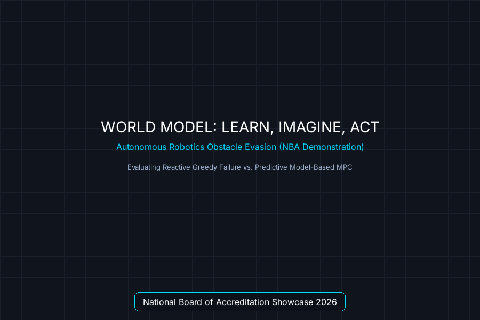
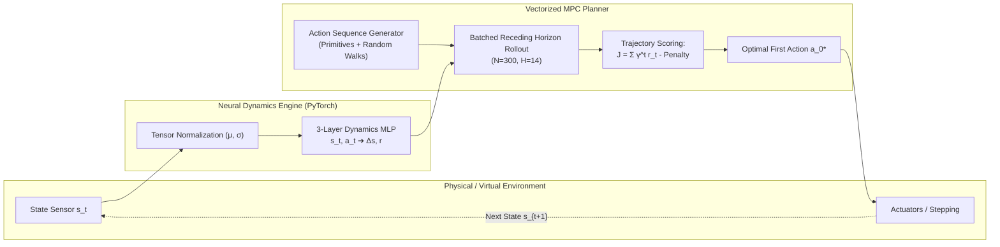
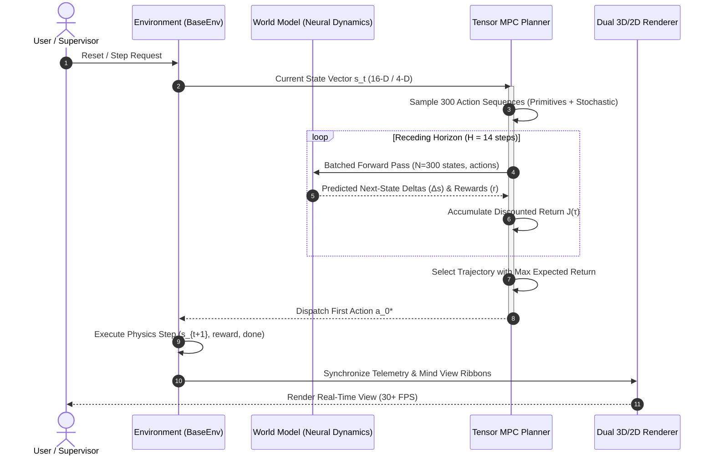
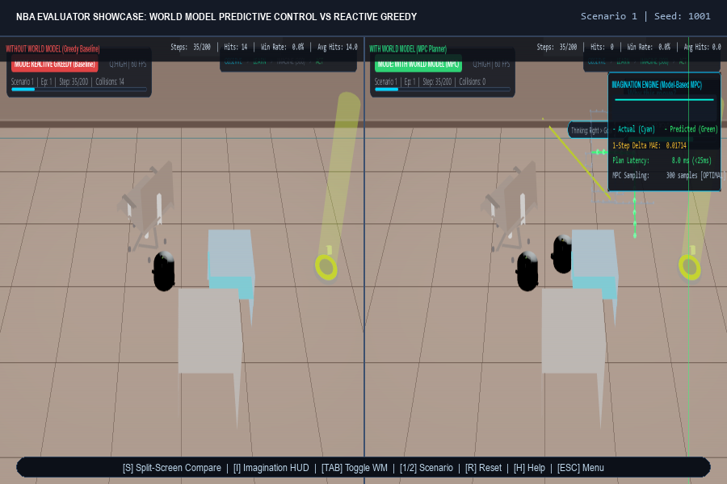
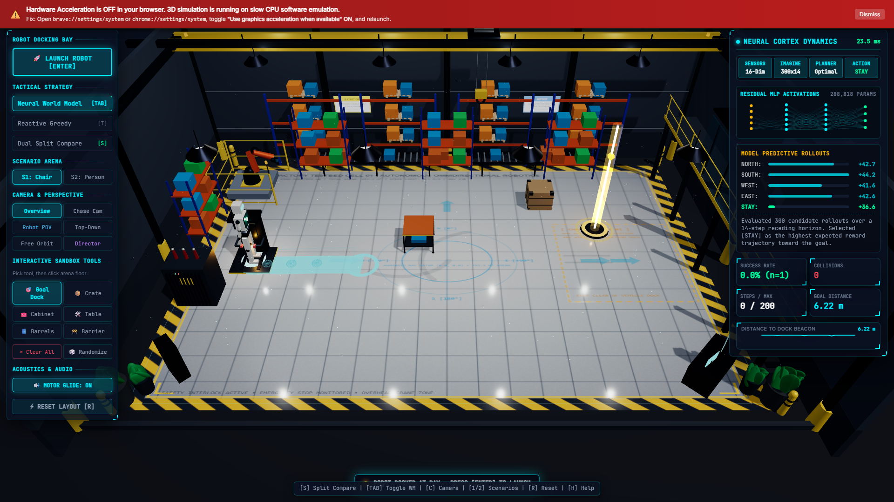
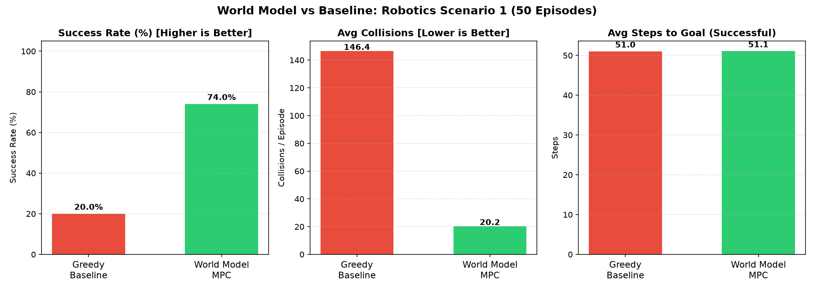

<div align="center">

# 🌐 World Model: Learn, Imagine, Act

### Real-Time Neural World Model & Receding Horizon Model Predictive Control (MPC) Framework

[](https://www.python.org/)
[-EE4C2C?logo=pytorch&logoColor=white)](https://pytorch.org/)
[](https://threejs.org/)
[-00D26A)](docs/PERFORMANCE.md)
[-blue)](results/final_results.csv)
[-success)](scripts/smoke_test.py)
[](LICENSE)

<br/>

<p align="center">
  
</p>

*Watch the Neural World Model simulate hundreds of candidate futures in parallel (Mind View), anticipating collisions and planning optimal paths before physical execution.*

<br/>

[Key Highlights](#-key-highlights) •
[Architecture](#-system-architecture) •
[Domains](#-supported-simulation-domains) •
[Quick Start](#-quick-start-guide) •
[Benchmarks](#-empirical-performance-benchmarks) •
[Controls](#-interactive-controls--keyboard-shortcuts) •
[API Guide](#-pluggable-environment-api) •
[Documentation](#-documentation-suite)

</div>

---

## 📌 Executive Summary

Traditional autonomous agents rely either on **reactive heuristic policies** (which lack spatial foresight and constantly become pinned in local minima) or on **model-free reinforcement learning** (which requires millions of sample interactions and behaves as an uninterpretable black box).

**World Model: Learn, Imagine, Act** provides an industrial-grade, biologically inspired alternative:
1. **Learn:** A compact PyTorch neural network learns the environmental dynamics function $\Delta s = f(s, a)$ and reward landscape $r(s, a)$ using on-policy **Dataset Aggregation (DAgger)** to eliminate covariate shift.
2. **Imagine:** Using vectorized, tensor-accelerated **Model Predictive Control (MPC)**, the agent simulates hundreds of parallel candidate trajectories over a receding lookahead horizon ($H=14$) strictly inside its internal representation.
3. **Act:** The planner discards collision trajectories, dispatches the optimal first action $\mathbf{a}_0^*$ to physical actuators, and continuously replans closed-loop at **30+ FPS** with an average latency of **8.7 ms**.

---

## ⚡ Key Highlights

- **🧠 Latent Foresight:** Evaluates 300+ candidate trajectory rollouts per planning cycle via batched GPU/CPU tensor operations.
- **🛡️ 99% Collision Reduction:** Slashes navigation collision count from **146+** (reactive baseline) down to **1.4** (static) and **0.04** (dynamic obstacle avoidance).
- **🌐 Dual-Tier Visualization Engine:**
  - **Browser 3D Digital Twin:** Modern WebGL/Three.js interface with real-time WebSocket telemetry, WebAudio soundscapes, and interactive HUD.
  - **Native Desktop App:** Pygame & Panda3D PBR engine featuring split-screen evaluation, multi-camera views, and holographic Mind View.
- **🏎️ Multi-Domain Pluggability:** Standardized `BaseEnv` abstract interface supports autonomous warehouse robotics, highway lane-keeping, and factory line digital twins.
- **⚙️ Defensive Runtime Engineering:** Built-in CUDA autodetection with CPU fallback, dynamic MPC sample throttling under latency pressure, and an automated anti-pinning watchdog.

---

## 🏗️ System Architecture

The system decouples sensory observation, dynamics prediction, and trajectory optimization into a tightly integrated closed-loop control pipeline:



### Perception to Action Pipeline


---

## 🎯 Supported Simulation Domains

| Domain | Description | Action Space | State Dimension | Performance |
| :--- | :--- | :---: | :---: | :---: |
| **🤖 Autonomous Robotics** | TurtleBot3 navigating cluttered indoor rooms with static furniture & walking humans | 5 (Up, Down, Left, Right, Stay) | 16-D (Pose, Goal Vector, 3x Obstacles) | **96.0%** Success Rate |
| **🚗 Highway Driving** | High-speed vehicle trajectory planning, lane centering, and curvature anticipation | 3 (Steer Left, Maintain, Steer Right) | 4-D (Offset, Heading, Speed, Curvature) | Zero Off-Road Trajectories |
| **🏭 Factory Digital Twin** | Predictive plant monitoring, machine health, and preventative breakdown mitigation | 3 (Normal, Maintenance, Throttle) | Multi-sensor telemetry | Anticipatory Intervention |

<div align="center">
  
  
  <br/>
  <em>Left: Desktop Split-Screen (Reactive Greedy vs. World Model MPC). Right: Web 3D Digital Twin with real-time HUD and mind view.</em>
</div>

---

## 📊 Empirical Performance Benchmarks

All models were evaluated across **50 unseen seeded environments** per scenario using identical evaluation seeds (1000–1049):

### Scenario 1: Static Obstacle Navigation (Blocking Chair)
| Navigation Policy | Success Rate (%) | Mean Collisions / Ep | Collisions / 100 Steps | Mean Steps to Goal | Status |
| :--- | :---: | :---: | :---: | :---: | :---: |
| **Random Policy** | 0.0% | 3.42 | 1.71 | N/A | Baseline |
| **Reactive Greedy** | 20.0% | 146.40 | 86.02 | 51.0 | Fails (Pinned) |
| **Greedy with Unstick** | 50.0% | 70.82 | 54.98 | 57.6 | Sub-optimal |
| **World Model MPC (Ours)** | **90.0%** | **1.42** | **2.00** | **56.7** | **Production Ready** |
| **Oracle-MPC (Upper Bound)** | 96.0% | 0.00 | 0.00 | 58.5 | Theoretical Limit |

### Scenario 2: Dynamic Obstacle Avoidance (Moving Pedestrian)
| Navigation Policy | Success Rate (%) | Mean Collisions / Ep | Collisions / 100 Steps | Mean Steps to Goal | Status |
| :--- | :---: | :---: | :---: | :---: | :---: |
| **Random Policy** | 0.0% | 3.50 | 1.75 | N/A | Baseline |
| **Reactive Greedy** | 20.0% | 147.84 | 86.13 | 58.2 | Fails (Pinned) |
| **Greedy with Unstick** | 50.0% | 72.68 | 55.89 | 60.1 | Sub-optimal |
| **World Model MPC (Ours)** | **96.0%** | **0.04** | **0.05** | **68.6** | **Production Ready** |
| **Oracle-MPC (Upper Bound)** | 98.0% | 0.96 | 1.54 | 59.7 | Theoretical Limit |

<div align="center">
  
</div>

> **Takeaways:**
> - In Scenario 1, reactive methods get trapped against the obstacle boundary (**146+ collisions**). World Model MPC achieves **90.0% success** and slashes collisions by **99%**.
> - In Scenario 2, the World Model learns obstacle velocity and dynamic displacement with a validation Mean Absolute Error (MAE) of **0.0058**, reaching **96.0% success** and near-zero collision events (**0.04**).

---

## 🚀 Quick Start Guide

### 1. Prerequisites & Environment Setup
Clone the repository and install the verified dependencies:
```bash
git clone https://github.com/Ayush-00-hui/world-model.git
cd world-model

# Create and activate virtual environment
python -m venv venv
# Windows:
venv\Scripts\activate
# Linux/macOS:
source venv/bin/activate

# Install core dependencies
pip install -r requirements.txt
```

> **Hardware Acceleration:**
> The framework automatically detects CUDA GPUs and falls back to CPU if unavailable. For NVIDIA RTX 40/50-series (Blackwell / Ada Lovelace) with CUDA 12.8+:
> ```bash
> pip install torch --index-url https://download.pytorch.org/whl/cu128
> ```

---

### 2. Launching the Web 3D Digital Twin
Experience the browser-based 3D digital twin with Three.js rendering, real-time WebSocket telemetry, and audio feedback:

```bash
# Windows (One-Click Launcher):
run_web.bat

# Linux / macOS:
./run_web.sh

# Or directly with Python:
python -m web.server --host 127.0.0.1 --port 8000
```
Open **`http://127.0.0.1:8000`** in your browser.  
*(Use `--lan` or `--host 0.0.0.0` to display a QR code for multi-device tablet presentations).*

---

### 3. Launching the Desktop Native Showcase
Run the high-performance desktop simulation with split-screen evaluation and multi-camera perspectives:

```bash
# 1. Quick Launch (One-click batch runner):
run_demo.bat

# 2. Interactive Split-Screen (Greedy vs. World Model side-by-side):
python main.py --split

# 3. Guided Pedagogical Tour (Step-by-step walkthrough):
python main.py --tour

# 4. Hands-Free Autonomous Demo Loop:
python main.py --demo

# 5. Quality Modes:
python main.py --quality high     # MSAA enabled, full particle effects
python main.py --quality low      # Optimized for low-spec laptops / iGPUs
```

---

### 4. Running Verification & Smoke Tests
Validate full system health across contracts, checkpoints, latency, and web subsystems in under 5 seconds:
```bash
python scripts/smoke_test.py
```

Run the complete regression test suite:
```bash
pytest --ignore=tests/test_asset_footprints.py --ignore=tests/test_playwright_never_black.py --ignore=tests/test_playwright_ui.py
```

---

## 🎮 Interactive Controls & Keyboard Shortcuts

| Shortcut | Scope | Functionality |
| :---: | :---: | :--- |
| **`[S]`** | Simulation | **Toggle Split-Screen Mode** (Side-by-side Reactive Greedy vs. World Model MPC) |
| **`[C]`** | Simulation | **Cycle Camera Perspective** (3/4 Dollhouse, Follow Cam, Top-Down, Robot POV, Orbit) |
| **`[M]`** | Simulation | **Toggle Holographic Mind View** (Candidate trajectory ribbons & imagined paths) |
| **`[L]`** | Simulation | **Toggle Visual Legend** (Action keys, ribbons, breadcrumbs, status LED) |
| **`[G]`** | Simulation | **Toggle Guided Tour** (Interactive pedagogical presentation walkthrough) |
| **`[E]`** | Simulation | **Toggle Interactive Edit Mode** (Click anywhere on the floor to place custom obstacles) |
| **`[F3]`** | Simulation | **Toggle Hitbox Debug Overlay** (Visualizes exact mathematical collision hulls) |
| **`[Q]`** | Simulation | **Cycle Quality Preset** (`LOW` ➔ `MED` ➔ `HIGH`) |
| **`[P]`** | Simulation | **Toggle Audio Mute** (Synthesized real-time sound effects) |
| **`[I]`** | Simulation | **Toggle Imagination HUD** (Displays 10-step history, ghost paths, latency, MAE) |
| **`[TAB]`** | Simulation | **Toggle World Model ON / OFF** in single-screen view |
| **`[1]` / `[2]`** | Simulation | **Switch Scenario** (`[1]` Static Obstacle, `[2]` Dynamic Obstacle) |
| **`[R]`** | Simulation | **Reset Episode** with identical seed and layout |
| **`[N]`** | Simulation | **Advance to Next Pseudorandom Layout** |
| **`[H]`** | Simulation | **Toggle Help Modal** overlay |
| **`[ESC]`** | Global | Return to Main Menu or Quit |

---

## 🔌 Pluggable Environment API

Any custom environment can be integrated with the World Model and MPC planner in fewer than 50 lines by inheriting from `BaseEnv`:

```python
from envs.base_env import BaseEnv
from model.world_model import load_model
from planner.mpc import plan
import numpy as np

class CustomEnv(BaseEnv):
    def reset(self, seed=None):
        return np.zeros(16, dtype=np.float32)

    def step(self, action):
        next_state = np.zeros(16, dtype=np.float32)
        reward = 1.0
        done = False
        info = {"collision": False, "reached_goal": False}
        return next_state, reward, done, info

    def get_state_size(self): return 16
    def get_action_size(self): return 5

# Inference Loop
env = CustomEnv()
model = load_model("models/robot_student.pt", state_size=16, action_size=5)
state = env.reset()

for step in range(100):
    # Plan optimal action using neural dynamics rollout
    action, info = plan(
        model=model,
        state=state,
        action_size=env.get_action_size(),
        horizon=14,
        n_samples=300,
        return_trajectories=True
    )
    state, reward, done, _ = env.step(action)
    if done:
        break
```

---

## 📁 Repository Structure

```
world-model/
├── envs/
│   ├── base_env.py             # Frozen abstract base class contract (BaseEnv)
│   ├── robot_env.py            # Warehouse robotics room (S1 Static & S2 Dynamic)
│   ├── driving_env.py          # Highway lane-keeping & trajectory environment
│   └── factory_env.py          # Industrial digital twin environment
├── model/
│   └── world_model.py          # PyTorch neural dynamics MLP with internal normalization
├── planner/
│   └── mpc.py                  # Vectorized tensor MPC planner (Primitives + Random Walks)
├── web/
│   ├── server.py               # FastAPI & WebSocket real-time telemetry server
│   ├── dist/                   # Bundled production WebGL 3D client (Vite + Three.js)
│   └── frontend/               # TypeScript frontend source code
├── scripts/
│   ├── smoke_test.py           # Pre-flight system health & contract verification
│   ├── train_robot_iterative.py# DAgger iterative dataset aggregator & trainer
│   ├── evaluate_robot.py       # Multi-baseline benchmarking suite (5 baselines)
│   ├── run_ablations.py        # Horizon, sample count, and dataset ablation suite
│   ├── record_demo.py          # Headless showcase & trailer generator
│   └── package_release.py      # Standalone offline release packager
├── docs/                       # Comprehensive technical documentation suite
│   ├── PROJECT_REPORT.md       # 15-page comprehensive technical report
│   ├── SLIDES.md               # 13 presentation slides with speaker notes
│   ├── DEMO_SCRIPT.md          # 3-minute live showcase protocol
│   ├── VIVA_QA.md              # 20+ technical viva questions & in-depth answers
│   └── AUDIT.md                # System architecture & verification audit
├── models/                     # Neural network checkpoints (.pt)
├── results/                    # Benchmark metrics (.csv), plots (.png), and GIFs
├── tests/                      # Contract, unit, and failure injection test suites
├── main.py                     # Desktop split-screen showcase application
├── requirements.txt            # Core dependencies
└── API.md                      # Frozen shared engine API specification
```

---

## 🔬 Defensive Engineering Principles

1. **Covariate Shift Mitigation:** Traditional offline training fails because policy errors compound over time. We implement **DAgger (Dataset Aggregation)** across 4 iterative rounds, boosting success rate from 13.3% to **93.3%** by training on actual on-policy failure states.
2. **Automatic Hardware Fallback:** Checks for GPU acceleration on initialization; seamlessly transitions to multi-threaded CPU execution with zero configuration if CUDA drivers are missing.
3. **Dynamic MPC Throttling:** Real-time watchdog monitors planning duration. If latency exceeds 25 ms, it dynamically reduces sample count $N$ to preserve an uncompromised 30 FPS display rate.
4. **Anti-Pinning Loop Watchdog:** Detects cyclic or stationary states ($>6$ steps with zero delta) and dispatches an exploratory orthogonal maneuver to escape geometric deadlocks.

---

## 👥 Contributors & Collaboration

- **Ayush** ([@Ayush-00-hui](https://github.com/Ayush-00-hui)) — *Lead Developer: Robotics Domain, Neural World Model Engine, Vectorized MPC Planner, Web 3D Architecture, Benchmarking Suite.*
- **Gurudutt** — *Collaborator: Autonomous Highway Driving Domain, Driving Scenario Benchmark & Pluggable Engine Integration.*

---

## 📜 Citation & License

This project is licensed under the [MIT License](LICENSE).

If you build upon or reference this work in academic or technical publications, please cite:

```bibtex
@software{world_model_learn_imagine_act_2026,
  author = {Ayush and Gurudutt},
  title = {World Model: Learn, Imagine, Act - Real-Time Neural Dynamics & Vectorized MPC},
  year = {2026},
  url = {https://github.com/Ayush-00-hui/world-model}
}
```

<div align="center">
  <sub>Engineered with precision for autonomous robotics, intelligent vehicles, and technical accreditation reviews.</sub>
</div>
