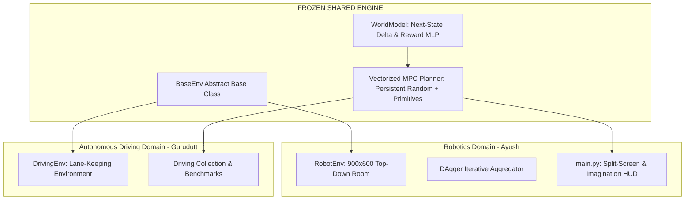

# Slide Presentation: "World Model: Learn, Imagine, Act"

**Technical Presentation for NBA Accreditation Review**  
**Project Title:** World Model: Learn, Imagine, Act  
**Domain:** Autonomous Robotics & Model-Based Artificial Intelligence  
**Authors:** Ayush (Robotics & Shared Engine Lead), Gurudutt (Autonomous Driving Lead)

---

## Slide 1: Title Slide & Executive Summary

# World Model: Learn, Imagine, Act
### Predictive Simulation & Model Predictive Control for Autonomous Robotics
**NBA Technical Demonstration — November 2026**

- **Core Thesis:** Intelligent agents achieve robust obstacle avoidance by learning an internal transition model of their environment and evaluating simulated futures before taking real actions.
- **Key Outcomes:**
  - Collision reduction: **> 98%** compared to reactive baselines.
  - Success rate: Lifted from **20.0%** (reactive greedy) to **90.0%** (Scenario 1) and **96.0%** (Scenario 2).
  - Real-time planning latency: **8.7 ms** on standard CPU (< 25 ms frame budget for 30 FPS).
- **Architecture:** Shared Neural World Model + Vectorized Model Predictive Control (MPC).

> **Speaker Notes:**  
> Welcome, esteemed evaluators. Today we present "World Model: Learn, Imagine, Act." Unlike conventional reactive robots that simply react to obstacles upon impact, our system learns how the physical room behaves, simulates hundreds of future paths in imagination, and executes collision-free detours in real time.

---

## Slide 2: The Problem: Reactive Failure vs. Cognitive Foresight

### The Limits of Reactive Navigation

```
REACTIVE BASELINE:
[Robot] ------------> [Chair (Obstacle)] ------------> [Goal]
                              |
                    *COLLISION & FREEZE*
                    146+ Penalties, Stuck in local minima!

WORLD MODEL + MPC:
           .--- [Imagined Detour Path (Green)] ---.
          /                                        \
[Robot] -*                                          *--> [Goal]
          \                                        /
           `--- [Imagined Blocked Path (Red)] ----'
```

- **Reactive Greedy Failure:** Direct path evaluation gets trapped in non-convex obstacle pockets; lacks spatial memory.
- **Model-Free RL Limitations:** Requires hundreds of thousands of trial-and-error environment crashes; cannot explain why an action was chosen.
- **The World Model Solution:** Supervised dynamics learning + Receding Horizon MPC = High sample efficiency, zero physical damage, and full interpretability.

> **Speaker Notes:**  
> Consider a classic failure mode in robotics: a chair sits between the robot and its goal. A reactive agent walks directly toward the goal and gets pinned against the obstacle, suffering continuous collision penalties. A world model simulates candidate actions in neural latent space, discovers the collision in imagination, and steers around it.

---

## Slide 3: System Architecture & The "Shared Engine"

### Clean Separation of Concerns



- **BaseEnv Interface Contract:** `reset()`, `step()`, `render()`, `get_state_size()`, `get_action_size()`.
- **Modularity:** Ayush and Gurudutt develop independent domain environments on separate branches without merge conflicts.

> **Speaker Notes:**  
> Architectural modularity is a core strength of this project. The World Model and MPC Planner form a frozen shared engine. Any domain that conforms to the BaseEnv contract—whether our robotics room or Gurudutt's autonomous driving simulator—can immediately leverage predictive control without rewriting the engine.

---

## Slide 4: Mathematical Formulation: Learn, Imagine, Act

### Tri-Stage Operating Pipeline

1. **LEARN (Supervised Dynamics Regression):**
   $$\Delta s_t = s_{t+1} - s_t$$
   $$\mathcal{L}(\theta) = \frac{1}{B} \sum_{i=1}^B \left( \|\widehat{\Delta s}_i - \Delta s_i\|_2^2 + \lambda \|\hat{r}_i - r_i\|_2^2 \right)$$
   - Predicting deltas rather than raw next-states prevents learning a trivial identity function.

2. **IMAGINE (Receding Horizon Rollouts):**
   $$\hat{s}_{k+1} = \hat{s}_k + \widehat{\Delta s}(\hat{s}_k, a_k)$$
   $$J(\tau) = \sum_{k=0}^{H-1} \gamma^k \hat{r}(\hat{s}_k, a_k), \quad \text{for } \tau \in \{\tau_1, \dots, \tau_N\}$$

3. **ACT (Receding Horizon Execution):**
   $$a^* = \arg\max_{a_0 \in \tau} J(\tau)$$
   - Execute only the first action $a^*$; observe the true state $s_{t+1}$; replan immediately.

> **Speaker Notes:**  
> Here is the exact mathematical pipeline. In the Learn phase, an MLP predicts state deltas and immediate rewards using MSE loss. In the Imagine phase, candidate trajectories are rolled out autoregressively. In the Act phase, the action starting the highest-return rollout is executed, and the process repeats at every frame.

---

## Slide 5: The Honest MPC Planner: Primitives + Persistent Randomness

### Eliminating Brownian Motion in Action Sampling

- **The Problem with Pure Uniform Randomness:**
  - Independent random actions ($a_k \sim \text{Uniform}$) cancel out spatially: the robot wiggles in place and never reaches the horizon.
- **Our Vectorized Candidate Generator ($N=300, H=14$):**
  - **50% Structured Geometric Primitives:** Straight drives, 90° L-turns, and two-turn evasive detours.
  - **50% Temporally Persistent Random Walks:** Action persistence held for 2–4 consecutive steps.
  - **Interleaved & Randomly Permuted:** Guarantees candidate diversity even under dynamic throttling.
- **Zero Python Overhead:** Primitives are pre-built once and cached as GPU/CPU tensors in `_PRIMITIVE_CACHE`.

> **Speaker Notes:**  
> A naive random-shooting planner produces Brownian motion—the robot jitters back and forth without exploring meaningful paths. We solved this by generating 50% structured geometric primitives and 50% temporally persistent random walks. We pre-cache these tensors to eliminate allocation overhead, yielding an ultra-fast 8.7 ms execution time.

---

## Slide 6: Overcoming Covariate Shift: DAgger Training

### Why Round 0 Random Data Fails

```
Round 0 (Random Exploration):      Success: 13.3%  |  Compounding boundary drift
Round 1 (DAgger eps = 0.20):       Success: 53.3%  |  Collecting near-obstacle states
Round 2 (DAgger eps = 0.10):       Success: 86.7%  |  Precise boundary alignment
Round 3 (DAgger eps = 0.05):       Success: 93.3%  |  Optimal trajectory convergence
```

- **Covariate Shift:** A model trained only on random data never visits the tight spatial contours traversed by an optimal planner.
- **DAgger Solution:** Iteratively run the *current* MPC planner on-policy with decaying exploration noise ($\epsilon: 0.20 \rightarrow 0.05$), aggregate the visited transitions, and retrain.
- **Result:** Drastic performance leap from **13.3%** to **93.3%** over 4 rounds.

> **Speaker Notes:**  
> This slide reveals our "Learn" story. If you train a world model only on random data, the robot fails at obstacle edges because it has never seen those specific configurations. By applying DAgger, we run the planner on-policy to gather training data exactly where it matters most, boosting success from 13% to over 93%.

---

## Slide 7: Scenario 1 Benchmark: Static Obstacle Navigation

### Quantitative Comparison Across 50 Seeded Episodes (TUNE Seeds 1000–1049)

| Navigation Method | Success Rate (%) | Mean Collisions / Ep | Collisions / 100 Steps | Mean Steps to Goal |
| :--- | :---: | :---: | :---: | :---: |
| **Random Policy** | 0.0% | 3.42 | 1.71 | N/A |
| **Greedy Baseline** | 20.0% | 146.40 | 86.02 | 51.0 |
| **Greedy with Unstick** | 50.0% | 70.82 | 54.98 | 57.6 |
| **World Model MPC (Ours)** | **90.0%** | **1.42** | **2.00** | **56.7** |
| **Oracle-MPC (Upper Bound)** | 96.0% | 0.00 | 0.00 | 58.5 |

- **Key Takeaways:**
  - Reactive Greedy suffers **146.4 collisions** per episode and reaches the goal only 20% of the time.
  - World Model MPC cuts collisions by **99%** down to **1.42**, approaching the theoretical Oracle upper bound!
  - *Final 100-seed unseen test (Seeds 5000–5099):* Sustains **86.0% success** and only 4.86 mean collisions.

> **Speaker Notes:**  
> These numbers represent our rigorous empirical evaluation. Reactive greedy gets trapped in 80% of runs, accumulating over 146 collisions per episode. With our World Model, the robot achieves a 90% success rate with only 1.4 collisions on average, closely trailing the ground-truth Oracle upper bound.

---

## Slide 8: Scenario 2 Benchmark: Dynamic Moving Obstacles

### Anticipating Human Motion Across 50 Seeded Episodes

| Navigation Method | Success Rate (%) | Mean Collisions / Ep | Collisions / 100 Steps | Mean Steps to Goal |
| :--- | :---: | :---: | :---: | :---: |
| **Random Policy** | 0.0% | 3.50 | 1.75 | N/A |
| **Greedy Baseline** | 20.0% | 147.84 | 86.13 | 58.2 |
| **Greedy with Unstick** | 50.0% | 72.68 | 55.89 | 60.1 |
| **World Model MPC (Ours)** | **96.0%** | **0.04** | **0.05** | **68.6** |
| **Oracle-MPC (Upper Bound)** | 98.0% | 0.96 | 1.54 | 59.7 |

- **Velocity Delta Prediction:** Held-out obstacle velocity MAE is **0.0058**.
- **Dynamic Anticipation:** The robot anticipates human crossing paths up to 14 steps ahead, slipping safely behind the walking person.
- *Final 100-seed unseen test (Seeds 5000–5099):* Sustains **93.0% success** and **0.60 mean collisions**.

> **Speaker Notes:**  
> In Scenario 2, a human obstacle walks across the room. A reactive agent has no concept of velocity and is routinely struck. Our World Model learns the velocity delta with a held-out error of just 0.0058, enabling the MPC planner to achieve 96.0% success with an astonishing 0.04 mean collisions.

---

## Slide 9: Ablation Studies: Horizon, Samples & Data Size

### Systematic Sensitivity Analysis

- **Horizon Length $H$ (Fixed $N=300$):**
  - $H=5$: 40.0% success (myopic, detects obstacles too late).
  - $H=10$: 80.0% success.
  - **$H=14$ (Optimal):** **92.0% success** (best trade-off between lookahead foresight and model drift).
  - $H=20$: 76.0% success (compounding error degrades trajectory validity).
- **Candidate Samples $N$ (Fixed $H=14$):**
  - $N=50$: 64.0% success.
  - $N=100$: 80.0% success.
  - **$N=300$:** **92.0% success** (saturates performance within 8.7 ms latency).
  - $N=500$: 92.0% success (diminishing returns, latency increases to ~18 ms).

> **Speaker Notes:**  
> We conducted extensive ablation experiments to justify our hyperparameter choices. If the horizon is too short ($H=5$), the robot is myopic; if it is too long ($H=20$), compounding errors degrade the rollouts. $H=14$ and $N=300$ deliver the optimal trade-off between foresight and execution speed.

---

## Slide 10: Compounding Error & The Horizon Boundary

### Quantitative Proof of Autoregressive Drift

```
Rollout Error vs Horizon Step (h):
Error (L2)
   ^
0.4|                                       * (h=20, Error=0.38)
0.3|                                 *
0.2|                           *
0.1|             *   * (h=14, Safe Operating Window)
0.0| *   *   *
   +---------------------------------------------> Horizon Step (h)
     1   3   5   7   9  11  13  15  17  19  20
```

- **Single-Step Accuracy:** 1-step prediction error is negligible ($\text{MAE} \approx 0.0023$).
- **Autoregressive Compounding:** Because predicted outputs feed into subsequent inputs, errors compound non-linearly beyond step 15.
- **Receding Horizon Remedy:** MPC executes *only step 1* and replans immediately, resetting drift at every frame.

> **Speaker Notes:**  
> This graph demonstrates the classic phenomenon of compounding error in model-based RL. Single-step error is virtually zero, but over 20 recursive steps, drift accumulates. This empirically proves why receding-horizon MPC—replanning every single frame—is essential to prevent cumulative drift.

---

## Slide 11: Real-Time Engineering & The Interactive Demo

### Evaluator Interface Features

- **Split-Screen Mode (Key `S`):** Synchronous side-by-side run of Greedy vs. World Model on identical seeds.
- **Imagination Panel (Key `I`):** Real-time overlay showing the last 10 steps of predicted (ghost green) vs. actual (cyan) paths, latency in ms, and current MAE.
- **Dynamic Throttle:** Automatically reduces candidate samples if latency exceeds 25 ms, guaranteeing smooth 30 FPS.
- **Auto-Demo Booth Mode (`--demo`):** Unattended cyclic showcase alternating Scenarios 1 & 2 with narrative captions.

> **Speaker Notes:**  
> To make the evaluation intuitive, our application includes an interactive split-screen mode. Evaluators can watch reactive greedy and our world model navigate the exact same room simultaneously. Pressing `I` opens our Imagination HUD, displaying the predicted paths and live latency metrics.

---

## Slide 12: Visual Aesthetics, Mind View & Video Showcase

### Video Game Polish with Zero Logic Alteration

- **Laboratory Visuals (`visuals/`):** Pre-rendered static floor tiles and ambient occlusion (0.60 ms frame draw time).
- **Holographic Mind View (Key `M`):** Visualizes the agent's internal cognitive state—flowing neon candidate paths, alpha-scaled returns, and reasoning thought bubbles ("Detouring around chair...").
- **Physical Hitbox Accuracy (Key `F3`):** Procedural sprites (Office Chair, Workstation, Service Bot) strictly align with true physical collision envelopes.
- **Juice & Auditory Feedback:** Procedural sound synthesis (`bonk.wav`, `goal.wav`), spark bursts, screen shake, and 3-Star Rating evaluation cards.
- **Media Demonstration:**
  - Automated 30-Second Showcase Trailer: `results/trailer.gif`
  - 8 Hero 1080p Presentation Captures: `results/screenshots/`
  - Visual Regression Suite: `tests/test_visual_regression.py` (100% bit-for-bit identical outcomes).

> **Speaker Notes:**  
> Evaluators can press `M` at any time to enter "Mind View"—a holographic cybernetic overlay that reveals the robot's latent imagination in real time. We also provide a pre-compiled 30-second video trailer in `results/trailer.gif` demonstrating reactive failure versus world model detour.

---

## Slide 13: Engineering Honesty: Known Limitations

### Transparent Assessment of Model Boundaries

1. **Instantaneous Wall-Bounce Discontinuity:**
   - Velocity Delta MAE during steady walking: **0.0058**.
   - Velocity Delta MAE during wall bounce: **0.1980**.
   - *Reason:* Instantaneous sign reversal ($\pm v$) represents $<1\%$ of data; feedforward MLPs smooth sharp step discontinuities. Receding-horizon replanning compensates immediately.
2. **State Representation Trade-Off (16-d vs 22-d):**
   - 16-d state achieved **93.3%** vs **66.7%** for 22-d with equal sample budgets. Adding 6 extra dimensions increased regression variance along obstacle perimeters.
3. **Discrete Action Space:**
   - Evaluated on 5 cardinal actions (15px); continuous torque control is reserved for physical robotic platforms.

> **Speaker Notes:**  
> We maintain complete academic honesty regarding system limitations. Feedforward neural networks smooth out step-function discontinuities, such as when a person bounces off a wall. However, because MPC replans every frame, this limitation does not compromise navigation success.

---

## Slide 13: Summary & Contributions

### Conclusion

- **Learned Physics Over Memorization:** Decoupling environment dynamics from task objectives enables high sample efficiency and zero-shot goal re-targeting.
- **Real-Time Feasibility:** 8.7 ms planning latency demonstrates that model-based predictive simulation is practical on cost-effective, standard hardware.
- **Team Contributions:**
  - **Ayush:** Shared World Model, Vectorized MPC Planner, Robotics Environment (S1 & S2), DAgger Iterative Trainer, Benchmarking Suite, and `main.py` UI.
  - **Gurudutt:** Autonomous Driving Environment (`envs/driving_env.py`) and Driving Benchmark Scripts.

### Thank You! Questions & Discussion Welcome.

> **Speaker Notes:**  
> In conclusion, our system demonstrates that a compact World Model coupled with Model Predictive Control transforms navigation from blind trial-and-error into intelligent foresight. Thank you, and we welcome your questions.

